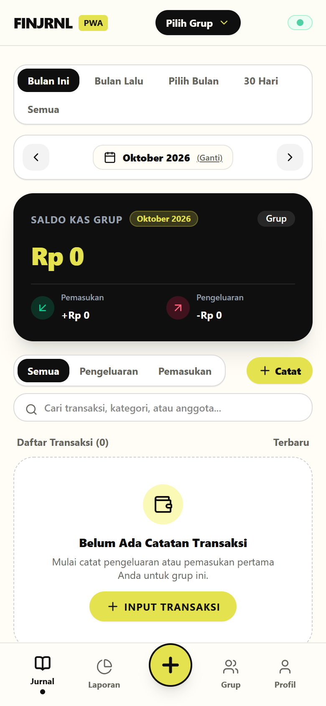
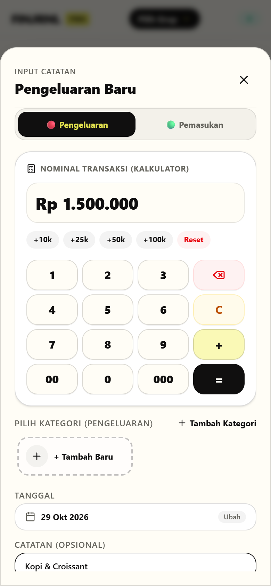
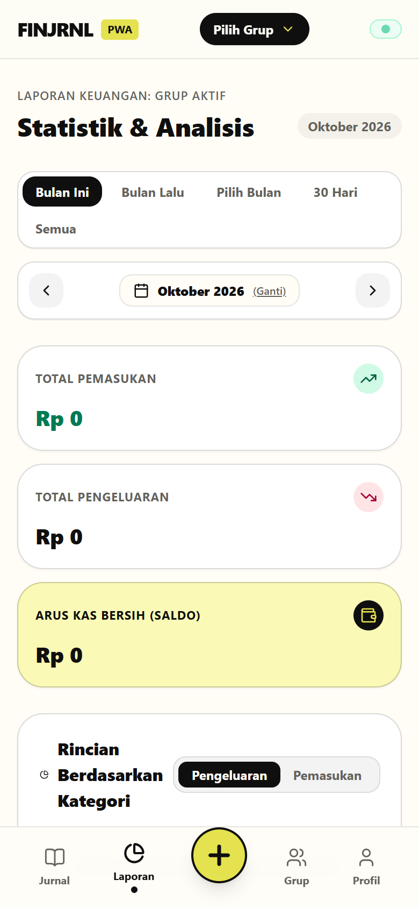
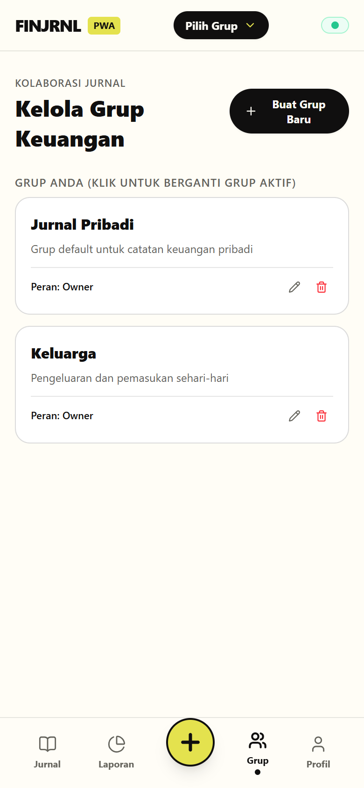
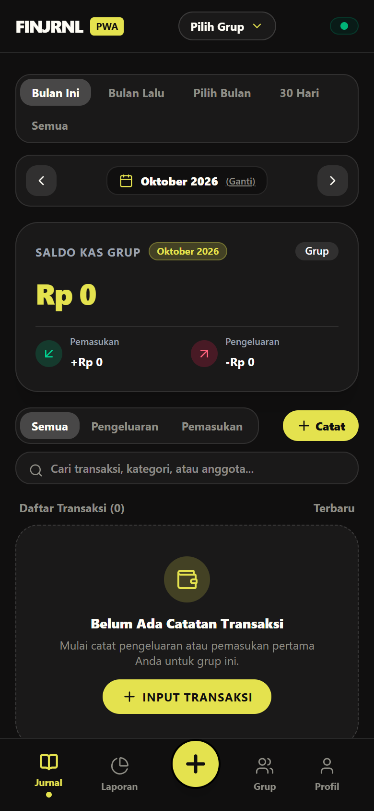
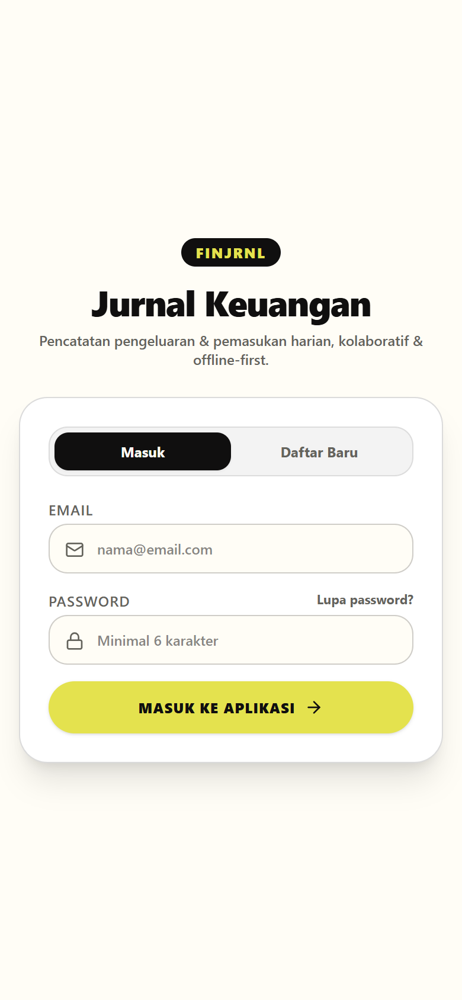
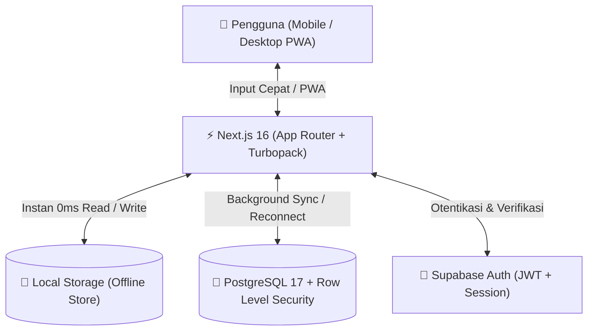

<div align="center">

# 💰 FINJRNL — Jurnal Keuangan

**Aplikasi Jurnal Keuangan Kolaboratif, Offline-First & Progressive Web App (PWA)**

[](https://nextjs.org/)
[](https://react.dev/)
[](https://tailwindcss.com/)
[](https://supabase.com/)
[](https://www.typescriptlang.org/)
[](https://web.dev/progressive-web-apps/)
[](https://github.com/estotriramdani/financial-journal-mobile.git)
[](LICENSE)

*Catat pemasukan dan pengeluaran harian secara cepat tanpa hambatan, kelola keuangan bersama keluarga atau tim secara real-time, dan tetap produktif bahkan saat tanpa koneksi internet.*

[Demo Aplikasi](https://financial-journal-six.vercel.app) • [📸 Tangkapan Layar](#-tangkapan-layar-aplikasi-mobile-view) • [📱 Repositori Versi Mobile](https://github.com/estotriramdani/financial-journal-mobile.git) • [Fitur Utama](#-fitur-utama) • [Instalasi Lokal](#-panduan-instalasi-lokal) • [Arsitektur](#-arsitektur--tech-stack) • [Pengujian](#-pengujian-end-to-end) • [Kontribusi](#-kontribusi)

---

</div>

> [!TIP]
> **Mencari Versi Aplikasi Mobile?**  
> Untuk melihat atau mengembangkan versi aplikasi seluler (native mobile app), silakan cek repositori berikut:  
> 📱 **[https://github.com/estotriramdani/financial-journal-mobile.git](https://github.com/estotriramdani/financial-journal-mobile.git)**

## 📱 Tangkapan Layar Aplikasi (Mobile View)

<div align="center">

| Jurnal & Saldo | Keypad Kalkulator | Laporan & Analisis |
|:---:|:---:|:---:|
|  |  |  |
| **Feed Transaksi & Saldo** | **Input Cepat Kalkulator** | **Statistik & Kategori** |

| Kelola Grup & Anggota | Mode Gelap (Dark Mode) | Masuk / Autentikasi |
|:---:|:---:|:---:|
|  |  |  |
| **Manajemen Kolaborasi Grup** | **Tampilan Tema Gelap** | **Autentikasi & Masuk** |

</div>

---

## 🌟 Tentang FINJRNL

**FINJRNL** adalah aplikasi pencatatan keuangan modern berorientasi *mobile-first* yang dirancang untuk mengatasi kelemahan aplikasi keuangan konvensional:
1. **Tidak bergantung koneksi internet (Offline-First)**: Input data disimpan instan di perangkat lokal dan disinkronkan secara otomatis begitu internet kembali terhubung.
2. **Kolaborasi Multi-Pengguna**: Satu akun dapat membuat beberapa grup keuangan (Keluarga, Bisnis, Liburan) dan mengundang anggota lain dengan sistem peran yang aman.
3. **Input Angka Cepat**: Dilengkapi kalkulator numerik bawaan pada layar (*on-screen keypad*) dengan tombol `00`, `000`, dan kalkulasi instan, tanpa mengganggu tampilan layar ponsel dengan virtual keyboard bawaan.

---

## ✨ Fitur Utama

- ⚡ **Offline-First & Auto-Sync**:
  - Menyimpan transaksi ke *Local Storage* secara optimistik tanpa *loading spinner*.
  - Sinkronisasi otomatis ke Supabase di latar belakang dengan resolusi konflik (*upsert* cerdas).
  - Indikator status transaksi lokal (badge *Lokal*) sebelum tersinkron ke cloud.

- 👥 **Kolaborasi Grup Keuangan**:
  - Buat dan kelola banyak grup keuangan dalam satu akun.
  - Dukungan peran anggota: `owner`, `admin`, dan `member`.
  - Undang anggota dengan mudah cukup melalui alamat email.
  - Kelola grup: Buat grup, ganti nama/deskripsi grup (*Edit Group*), dan hapus grup (*Delete Group*).

- 🔢 **Kalkulator Numerik Terintegrasi (On-Screen Keypad)**:
  - Input nominal transaksi super cepat dengan layout kalkulator interaktif.
  - Tombol pintas pecahan rupiah: `00` dan `000`.
  - Dukungan operasi matematika langsung (penjumlahan `+` dan kalkulasi `=`).
  - Mencegah pop-up keyboard ponsel yang sering menutupi formulir input.

- 📅 **Filter Periode & Navigator Bulan Global**:
  - Filter cepat: *Bulan Ini*, *Bulan Lalu*, *Pilih Bulan*, *30 Hari Terakhir*, dan *Semua Waktu*.
  - Navigasi bulan interaktif (`<` dan `>`) dengan pemilih bulan native kalender.
  - Menggunakan **Global React Context** &mdash; filter bulan di halaman Jurnal dan halaman Laporan selalu tersinkronisasi.

- 📊 **Laporan Statistik & Analisis Visual**:
  - Ringkasan Arus Kas Bersih (*Net Cash Flow*), Total Pemasukan, dan Total Pengeluaran.
  - Rincian persentase pengeluaran berdasarkan kategori disertai *progress bar* dan warna visual.
  - Statistik kontribusi masing-masing anggota grup.

- ✏️ **Manajemen Transaksi Lengkap**:
  - Tambah, edit, dan hapus transaksi dengan proteksi otorisasi pengguna.
  - Pencarian transaksi instan berdasarkan keterangan, kategori, maupun nama pencatat.
  - Tombol edit yang jelas dan responsif pada kartu transaksi.

- 📱 **Progressive Web App (PWA)**:
  - Dapat diinstal di layar utama (iOS, Android, macOS, Windows).
  - Mendukung mode layar penuh (*standalone*).
  - Pengecek versi otomatis (*Version Updater*) yang memberitahu pengguna jika ada pembaruan kode tanpa perlu membersihkan cache manual.

- 🌓 **Mode Gelap & Terang (Dark/Light Mode)**:
  - Pilihan tema Gelap, Terang, atau mengikuti preferensi sistem operasi.
  - Palet warna *high-contrast fintech* yang nyaman di mata.

- 🛡️ **Panel Administrator & Aktivasi Manual**:
  - Role khusus `admin` untuk mengelola daftar pengguna terdaftar.
  - Tombol aktivasi akun manual langsung dari dashboard (berguna saat pengujian atau jika email verifikasi tertunda).
  - Reset password pengguna langsung oleh admin.

- ✉️ **Kustomisasi Email Transaksional**:
  - Template email HTML profesional dan responsif bertema FINJRNL untuk verifikasi akun dan reset sandi.
  - Konfigurasi URL domain produksi yang siap dihubungkan ke layanan SMTP kustom (Resend, SendGrid, Mailgun).

---

## 🛠️ Arsitektur & Tech Stack



- **Framework**: [Next.js 16 (App Router)](https://nextjs.org/) dengan Turbopack
- **UI & State**: [React 19](https://react.dev/), React Context API
- **Styling**: [Tailwind CSS v4](https://tailwindcss.com/)
- **Icons**: [Lucide React](https://lucide.dev/)
- **Backend & Database**: [Supabase](https://supabase.com/) (PostgreSQL 17 dengan RLS)
- **Otentikasi**: Supabase Auth (Email & Password, SSR Client)
- **E2E Testing**: [Playwright](https://playwright.dev/)
- **Package Manager**: [pnpm](https://pnpm.io/)

### API Mobile (`/api/mobile/*`)

Repo ini juga menjadi backend untuk aplikasi Flutter [financial-journal-mobile](../financial-journal-mobile).
Layer REST di `app/api/mobile/` (auth login/register/refresh, bootstrap, transactions CRUD,
categories, groups, summary, health) memakai **bearer token user** — bukan service-role — sehingga
Row Level Security Supabase tetap menjadi penegak izin. Semua route menyertakan header CORS.

```bash
# smoke test end-to-end (server harus berjalan)
node scripts/smoke-mobile-api.mjs [BASE_URL]
```

---

## 🚀 Panduan Instalasi Lokal

### 1. Prasyarat
- [Node.js](https://nodejs.org/) v20.x atau lebih baru
- [pnpm](https://pnpm.io/installation) v9.x atau lebih baru
- Akun [Supabase](https://supabase.com/) (gratis)

### 2. Kloning Repositori
```bash
git clone https://github.com/estotriramdani/financial-journal.git
cd financial-journal
```

### 3. Instal Dependensi
```bash
pnpm install
```

### 4. Konfigurasi Environment Variable
Salin file `.env.example` menjadi `.env.local`:
```bash
cp .env.example .env.local
```

Buka `.env.local` dan isi kredensial Supabase Anda:
```env
NEXT_PUBLIC_SUPABASE_URL=https://your-project.supabase.co
NEXT_PUBLIC_SUPABASE_PUBLISHABLE_KEY=your-supabase-publishable-key
SUPABASE_SERVICE_ROLE_KEY=your-supabase-service-role-key
NEXT_PUBLIC_APP_URL=http://localhost:3000
```

### 5. Setup Database Supabase
Jalankan file migrasi SQL yang tersedia di direktori `supabase/migrations/` pada SQL Editor di dashboard Supabase Anda:
- `supabase/migrations/20261027130000_init_schema.sql` (Skema profil, grup, anggota, kategori, transaksi, dan kebijakan RLS).
- `supabase/migrations/20261027140846_fix_group_members_rls_recursion.sql` (Optimasi RLS group members).

### 6. Menjalankan Server Pengembangan
```bash
pnpm dev
```
Buka peramban Anda di [http://localhost:3000](http://localhost:3000).

---

## 🧪 Pengujian End-to-End

Proyek ini telah dilengkapi dengan suite pengujian otomatis menggunakan **Playwright** untuk menguji alur aplikasi secara menyeluruh:

```bash
# Menjalankan suite pengujian E2E Playwright
node scripts/e2e-test.mjs
```

Skenario pengujian mencakup:
1. Otentikasi Admin, pengecekan panel admin, aktivasi akun, dan mode gelap.
2. User 1: Pembuatan grup, edit grup, hapus grup, dan undang anggota via email.
3. Input pengeluaran & pemasukan menggunakan on-screen keypad kalkulator.
4. Edit transaksi langsung dari daftar riwayat.
5. Filter laporan bulan interaktif & sinkronisasi global context.
6. User 2: Login kolaboratif, pengecekan transaksi bersama, dan input transaksi anggota.
7. Simulasi Offline: Input data saat jaringan putus (offline) dan verifikasi auto-sync saat jaringan online kembali.

---

## 📁 Struktur Direktori

```text
financial-journal/
├── app/                        # Next.js 16 App Router
│   ├── api/                    # API Route Handlers (Admin, Version checker)
│   ├── auth/callback/          # Supabase Auth redirect callback
│   ├── reset-password/         # Halaman ganti password baru
│   ├── layout.tsx              # Root Layout dengan DateFilterProvider & PWA
│   └── page.tsx                # Halaman utama (Jurnal, Laporan, Grup, Profil)
├── components/                 # Komponen antarmuka pengguna
│   ├── AddTransactionModal.tsx # Modal input transaksi + Kalkulator numerik
│   ├── AuthView.tsx            # Form Login, Register, & Lupa Password
│   ├── BottomNav.tsx           # Navigasi bawah gaya aplikasi seluler
│   ├── GroupManagement.tsx     # Manajemen grup, anggota, dan undangan
│   ├── MonthFilterBar.tsx      # Komponen filter bulan dan navigator < >
│   ├── Navbar.tsx              # Top bar pemilih grup & status koneksi
│   ├── ProfileSettings.tsx     # Pengaturan profil, tema, panel admin, & PWA
│   ├── ReportsView.tsx         # Statistik, visualisasi kategori, dan arus kas
│   └── TransactionCard.tsx     # Kartu transaksi dengan tombol aksi edit/hapus
├── context/                    # React Contexts
│   └── DateFilterContext.tsx   # Global Context filter tanggal & transaksi
├── public/                     # Aset statis & manifes PWA
│   ├── icons/                  # Ikon aplikasi berbagai ukuran
│   ├── manifest.json           # Konfigurasi PWA Web App Manifest
│   └── sw.js                   # Service Worker untuk caching offline
├── scripts/                    # Skrip utilitas & pengujian
│   ├── e2e-test.mjs            # Otomasi pengujian E2E Playwright
│   └── seed-admin.mjs          # Skrip bootstrap akun administrator awal
├── supabase/                   # Konfigurasi Supabase
│   ├── config.toml             # Konfigurasi CLI & autentikasi Supabase
│   ├── migrations/             # Skrip SQL skema tabel dan RLS Postgres
│   └── templates/              # Template email HTML (Konfirmasi & Reset)
└── utils/                      # Helper & utilitas
    ├── storage.ts              # Sync engine lokal & manajemen offline-first
    ├── supabase/               # Inisialisasi Supabase client & server
    └── url.ts                  # Resolusi URL dinamis aplikasi
```

---

## 🌐 Panduan Deployment

### Deploy ke Vercel
1. Hubungkan repositori GitHub Anda ke [Vercel](https://vercel.com).
2. Tambahkan variabel lingkungan dari `.env.local` pada pengaturan proyek di Vercel:
   - `NEXT_PUBLIC_SUPABASE_URL`
   - `NEXT_PUBLIC_SUPABASE_PUBLISHABLE_KEY`
   - `SUPABASE_SERVICE_ROLE_KEY`
   - `NEXT_PUBLIC_APP_URL` (contoh: `https://financial-journal-six.vercel.app`)
3. Jalankan *Deploy*.

### Sinkronisasi Konfigurasi Supabase ke Production
Gunakan Supabase CLI untuk menyinkronkan pengaturan Redirect URL dan Site URL:
```bash
# Push konfigurasi auth dan redirect URL ke project Supabase live
pnpm exec supabase config push --yes
```

---

## 🤝 Kontribusi

Kontribusi dari komunitas sangat diterima! Untuk berkontribusi:
1. *Fork* repositori ini.
2. Buat *feature branch* baru: `git checkout -b feature/fitur-keren`.
3. Lakukan *commit* perubahan: `git commit -m 'feat: menambahkan fitur keren'`.
4. *Push* ke branch Anda: `git push origin feature/fitur-keren`.
5. Buka *Pull Request* baru di GitHub.

---

## 📄 Lisensi

Didistribusikan di bawah Lisensi MIT. Lihat file `LICENSE` untuk informasi lebih lanjut.

---

<div align="center">
  Dibuat dengan ❤️ untuk kemudahan pengelolaan finansial yang lebih transparan dan efisien.
</div>
